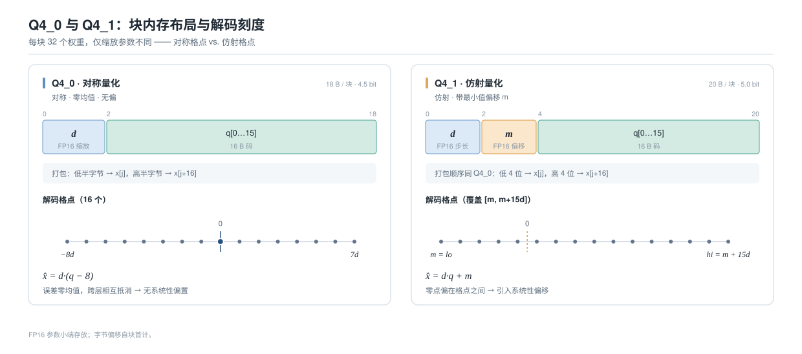
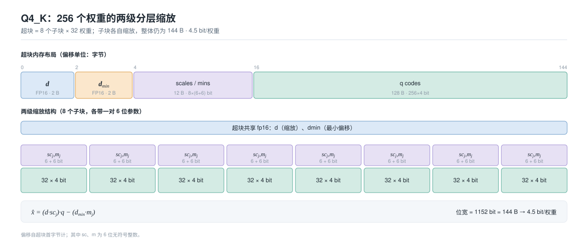
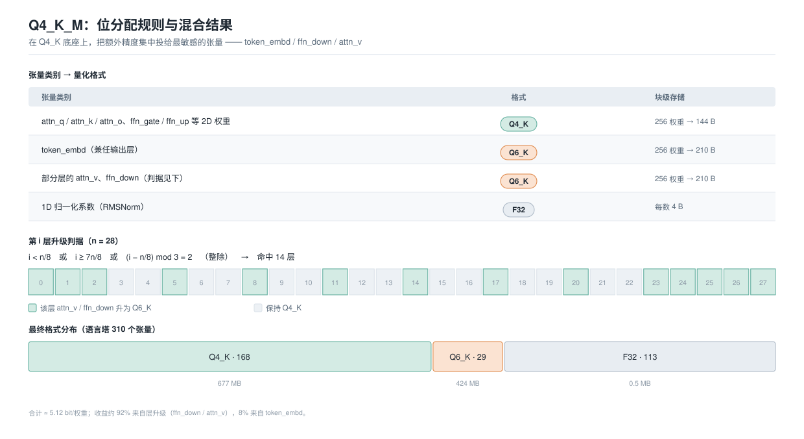
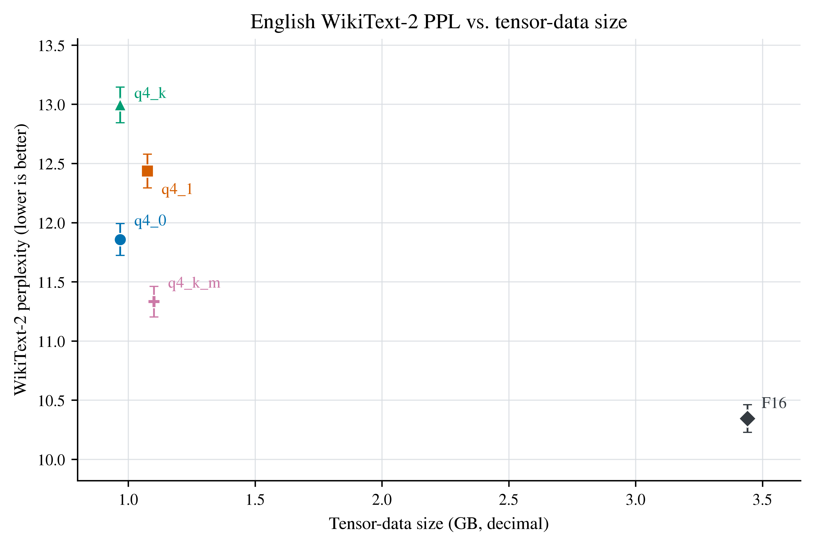
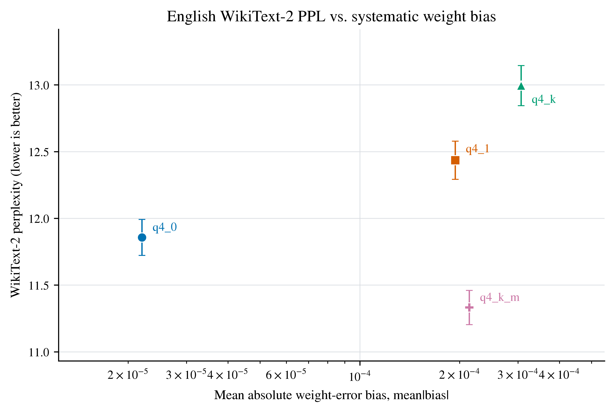
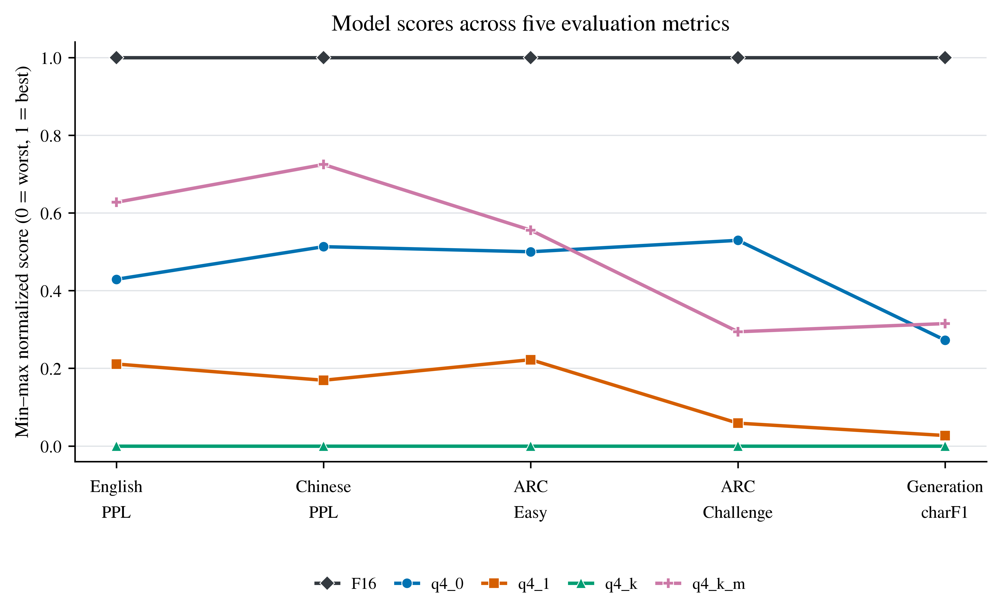

## Intro：一份 Lab 和它引出的疑问

Lab 的内容很朴素：**把 Qwen3-VL-2B-Instruct 的语言塔从 BF16 量化到 4 位**。
这个模型原始权重有 **4 255 140 312 字节**（约 4.25 GB，625 个张量，BF16），
其中语言部分 310 个张量、3.44 GB 需要被量化，视觉塔 315 个张量直接跳过。

Lab 要求实现三种 4 位格式（Q4_0 / Q4_1 / Q4_K）的编码与还原，然后把结果组装成 GGUF
交给 Ollama 加载。检查通过、md5 对上、模型能通顺地讲中文，作业就算做完了。

但做完之后，一个问题萦绕在我的脑海里：

> **量化的损失到底“长什么样”？把 16 位压到 4 位，掉的是 0.5 bit 的精度，还是某种更本质的东西？**

尤其是，作业文档里同时给出了 Q4_0、Q4_1、Q4_K 三种格式，还有一条现成的 **Q4_K_M** 混合配方。

直觉上“位数越多越好、格式越复杂越好”。如果真是这样，那答案就太平凡了。

于是我决定把作业扩展成一次真正的小型研究：**把五个模型文件（F16 参考 + 四个量化配方）
都用同一条流水线导出来，然后在同一引擎、同一模板、同一 greedy 解码下做对照实验**。
结果完全出乎我的意料——这篇博客就是这次旅程的记录。

如果你感兴趣的话，可以从 IPADS 实验室的 OS Course Repo 中获取这个 Lab。NanoQuant Lab 位于 ICS-Labs 目录。祝愿你也能有一次美好的 Lab 之旅。^_^

::github{repo="SJTU-IPADS/OS-Course-Lab"}

---

## 一、三种 4 位量化格式，到底在算什么

### 1.1 为什么是 4 位

一个神经网络推理时，绝大部分时间花在“权重 × 激活”的乘加上。乘法本身很快，
**真正的瓶颈是把 3.44 GB 的权重从显存/内存搬进计算单元**——这叫 memory-bound（访存受限）。
把权重从 16 位压到 4 位，**带宽需求直接降到 1/4**，这正是量化的核心收益。

量化做的事很简单：把每一个浮点权重 $x$ 映射成一个小的整数码 $q$，再乘一个缩放系数还原回去：

$$
x \approx \text{scale} \cdot q + \text{offset}, \qquad q \in \{0,1,\dots,15\}
$$

4 位就是 $2^4 = 16$ 个离散格点（对应数轴上的整数点）。孤立地看一个权重，误差上界是“码距的一半 × 缩放系数”。

但怎么切分这 16 个格点、缩放系数怎么定、每多少个权重共享一组缩放系数——**这就是 Q4_0 / Q4_1 / Q4_K 三者的全部区别**。

### 1.2 Q4_0：对称 4 位

Q4_0 是最“朴素”的想法。它把每 **32 个权重分成一块**，整块共享一个 fp16 缩放系数 $d$，
权重量化成 16 个**关于 0 对称**的格点：

$$
\hat x_i = d\,(q_i-8), \qquad q_i \in \{0,\dots,15\}.
$$

注意 $q_i - 8$ 落在 $[-8, 7]$，是**零均值**的。缩放系数由块内绝对值最大的权重决定：
取带符号的 `amax`，令

$$
d=\frac{\text{amax}}{-8},
$$

这样幅值端点恰好落在码 0 和码 15 上。编码时：

$$
q_i=\text{int}\bigl(x_i/d+8.5\bigr),\quad \text{再夹到}\ [0,15].
$$

误差上界约 $|d|/2$。**关键性质：对称格点、零均值、没有偏置项**。

每块 32 个权重占 **18 字节**（2 字节 fp16 的 $d$ + 16 字节编码），
理论位宽 $18\times 8/32 = 4.5$ bit/权重。

### 1.3 Q4_1：非对称 4 位

Q4_1 的想法是：如果权重的分布不是关于 0 对称的（比如全为正、或偏在一侧），
那对称量化会浪费一半的格点。于是它引入一个**最小值偏移** $m$，做仿射量化：

$$
\hat x_i = d\,q_i + m, \qquad q_i \in \{0,\dots,15\}.
$$

用块内的最小值和最大值定出：

$$
m = lo,\qquad d = \frac{hi - lo}{15},
$$

码 0 对应 $lo$、码 15 对应 $hi$，编码 $q_i=(\text{int})\bigl((x_i-lo)/d+0.5\bigr)$。
误差上界 $d/2 = (hi-lo)/30$。

看起来 Q4_1 更“聪明”：它能自适应任意区间。代价是**每块多存一个 fp16 的 $m$**，
所以每块 20 字节、位宽升到 **5.0 bit/权重**。

对称 vs 仿射的差别，可以从这张图中直观地理解：



### 1.4 Q4_K：二级量化

Q4_0 和 Q4_1 的痛点是：**整块 32 个权重共享一个缩放系数**。
如果这一块里既有很小的权重、又有离群的大权重，那把 $d$ 定大，小权重就被量化成 0 了。

Q4_K 的思路是**在一个更大的超块里，做两级、分层级的缩放**。
它以 **256 个权重为一个超块**，分成 **8 个子块，每个子块 32 个权重**，每个子块**有自己的**缩放和偏移：

$$
x_i \approx s_j\,q_i - o_j,\qquad s_j,o_j\ge 0,\quad j=0..7.
$$

如果这 8 对 $(s_j, o_j)$ 老老实实各存一对 fp16，每超块要 $8\times 32 = 256$ 位，
加上编码 $256\times4=1024$ 位，位宽会飙到 5.0 bit，等于没省。Q4_K 的**精妙之处**在于：
它把 $s_j, o_j$ **再量化一次**，用超块共用的 fp16 系数 × 子块的 6 位整数表示：

$$
s_j=d\cdot sc_j,\qquad o_j=d_{\min}\cdot m_j,\qquad sc_j,m_j\in\{0,\dots,63\}.
$$

最终还原：$\hat x_i=(d\,sc_j)q_i-(d_{\min}m_j)$。位预算刚好卡进 4.5 bit：

$$
\underbrace{32}_{d,\,d_{\min}}+\underbrace{96}_{8\times(6+6)}+\underbrace{1024}_{256\times4}
=1152\ \text{bit}=144\ \text{byte},\qquad 4.5\ \text{bit/权重}.
$$

即：**8 对 fp16 缩放（256 位）被压成了 128 位**（两个 fp16 + 96 位整数），
省下的位数让“每 32 个权重就有一套自己的缩放”。这就是 Q4_K 能在**和 Q4_0 一样的 4.5 bit 下**
换来更低量化误差的原因。它的结构：



Q4_K 的量化分三步：
先用加权最小二乘（$w_i=\sqrt{\overline{x^2}}+|x_i|$，离 0 远的权重权重更大）拟合每子块的 $(s_j,o_j)$；
再把 8 对缩放压成 6 位整数；最后**按解码端实际读到的 $\hat d,\hat d_{\min}$ 重算 4 位编码**，
保证编码与还原严格自洽。

### 1.5 三者对照

| 格式                | 每块权重数 | 每块字节 |   理论位宽 | 块内容                                 | 格点性质          |
| ----------------- | ----: | ---: | -----: | ----------------------------------- | ------------- |
| **Q4_0**          |    32 |   18 |    4.5 | fp16 `d` + 16B 编码                   | 对称、零均值、**无偏** |
| **Q4_1**          |    32 |   20 |    5.0 | fp16 `d`、`m` + 16B 编码               | 仿射、**带偏移**    |
| **Q4_K**          |   256 |  144 |    4.5 | fp16 `d`、`dmin` + 12B 缩放段 + 128B 编码 | 两级缩放、**带偏移**  |
| *Q6_K（ Lab 框架提供）* |   256 |  210 | 6.5625 | fp16 `d` + 16×int8 缩放 + 192B 编码     | 6 位、更细        |

>关于量化方法的更多细节见 [ICS Study Note](../ics-learning)。

到这里，把量化的数学原理转换成 Code，Lab 就基本做完了。

但是，让我十分好奇的是，**不同的量化方法究竟对模型性能产生了怎样的影响**，又是**为什么会产生这些影响呢**，这背后的**底层原理**是怎样的？

---

## 二、完成 Lab 后的进一步实验

### 2.1 导出五个模型文件

做扩展实验的**第一件事**，是给流水线加了一个**参考配方 `f16`**——不是随手用外部工具转一个 GGUF，而是用**同一条 `nano-quant quant → nq2gguf` 流水线**生成 F16（近无损）参考。
原因大概类似控制变量的方法：

> **参考基准必须和量化产物“同引擎、同模板、同元数据、同张量顺序”。**
> 否则引擎/格式差异会混进“量化损失”里，让所有对比失去意义。

于是我用如下命令得到了五个模型文件（数据区字节数、压缩比如下）：

```bash
./nano-quant quant model/model.safetensors --recipe f16    -o model/f16.nq
./nano-quant quant model/model.safetensors --recipe q4_0   -o model/q4_0.nq
./nano-quant quant model/model.safetensors --recipe q4_1   -o model/q4_1.nq
./nano-quant quant model/model.safetensors --recipe q4_k   -o model/q4_k.nq
./nano-quant quant model/model.safetensors --recipe q4_k_m -o model/q4_k_m.nq
for r in f16 q4_0 q4_1 q4_k q4_k_m; do
    ./nq2gguf model/$r.nq --meta model/meta.kv -o model/$r.gguf
done
```

| 配方 | 数据区字节 | 有效位宽 (bit/权重) | 数据减少率 | 相对 F16 压缩比 |
| --- | ---: | ---: | ---: | ---: |
| F16（参考） | 3 441 397 760 | 16.00 | — | 1× |
| `q4_0` | 968 249 344 | 4.5020 | 71.86% | 3.554× |
| `q4_1` | 1 075 777 536 | 5.0019 | 68.74% | 3.199× |
| `q4_k` | 968 249 344 | 4.5020 | 71.86% | 3.554× |
| `q4_k_m` | 1 101 457 408 | 5.1213 | 67.99% | 3.124× |

> 注意 `q4_0` 与 `q4_k` 位宽、数据区字节**完全相同**——它们是一对天然对照。
> `q4_k_m` 因为混用了 6 位，位宽和体积都略大。

### 2.2 Q4_K_M：混合量化

作业里给的默认配方是 `q4_k_m`。但这很容易让人产生疑问——它为什么要“混”、多出来的位数又花在了哪里？下面就`q4_k_m`的使用动机和其背后的位分配规则展开分析。

**动机：一刀切的位宽分配不是最优的。** Transformer 里，不同张量对量化的**敏感度天差地别**：

- `token_embd`（词嵌入，因 `tie_word_embeddings=true` 还兼任输出层）直接影响 logits；
- `ffn_down`（把扩展后的中间激活投影回残差流）的误差会**直接进入逐层累积的残差通道**；
- `attn_v`（注意力的 value 投影）同样作用于残差主干；
- 而 `attn_q`、`attn_k`、`ffn_gate`、`ffn_up` 则相对“耐压”。

既然敏感度如此不均，更聪明的做法就是：**在平均 4.5 位附近，把宝贵的额外位数集中投给最敏感的那几个张量**。这正是 `Q4_K_M`（M = mixed，混合）的全部思想。

**数学原理：一条带异常值感知的位分配规则。** `q4_k_m` 与 llama.cpp 的同名配方一致，规则很简单：

1. `embed_tokens`（兼任输出层）升为 **Q6_K**；
2. 部分层的 `v_proj`（→`attn_v`）和 `down_proj`（→`ffn_down`）升为 **Q6_K**，判据沿用 llama.cpp 的 `use_more_bits`：层数 $n=28$ 时，第 $i$ 层只要满足下面任一条即升级：

$$
i<\frac{n}{8}\quad\text{或}\quad i\ge\frac{7n}{8}\quad\text{或}\quad \Bigl(i-\frac{n}{8}\Bigr)\bmod 3=2
$$

对 $n=28$ 解得 **14 层**（0,1,2,5,8,11,14,17,20,23,24,25,26,27）；其余 2D 权重用 Q4_K，1D 归一化系数保持 F32。

**为什么偏偏是 `ffn_down`？** 从数学上看，$ffn\_down$ 的输入是 FFN 中间激活 $\text{silu}(xW_{gate})\odot(xW_{up})$，其权重动态范围大、常含离群值（outlier）。Q6_K 有 **64 个量化格点**（对比 4 位的 16 个），码距更细，**恰好能罩住这些离群值的尾部**。一旦 `ffn_down` 的精度提高，汇入残差流的扰动就小了；而残差流是**逐层累加**的——在这里省下的误差，会被后面每一层“继承”。



最终 `q4_k_m` 输出里的格式分布：

| 格式   | 张量数 |         字节数 |           权重数 |
| ---- | --: | ----------: | ------------: |
| Q4_K | 168 | 677 117 952 | 1 203 765 248 |
| Q6_K |  29 | 423 843 840 |   516 685 824 |
| F32  | 113 |     495 616 |       123 904 |

> 到这里，我们手里就有了五个可对比的同源模型。后续利用这 5 个模型展开实验。

### 2.3 模型数据的性质对比

拿到五个 `.gguf` / `.nq` 之后，第一步是对**权重数据本身**做静态比较。
我关注的指标有三类，逐张量、逐层、按张量类型统计：

- **相对均方根误差** $\text{RMS}/\lVert x\rVert = \sqrt{\sum_i(\hat x_i-x_i)^2 / \sum_i x_i^2}$——误差“有多大”；
- **最大绝对误差** $\max_i|\hat x_i-x_i|$；
- **有效位宽 / 压缩比 / 数据区字节**——误差“换来多少收益”。

在此之前，先用框架自带的 `nq-selftest` 在 512 个构造块 + 随机块上验证三种格式实现是否正确：

| 格式 | 相对均方根误差 | 最大绝对误差 |
| --- | ---: | ---: |
| Q4_0 | 0.08408 | 8 |
| Q4_1 | 0.07855 | 5.98438 |
| Q4_K | 0.07146 | 5.87793 |
| Q6_K | 0.01793 | 1.53906 |

这些数值与文档给的期望值一致，`make test` 全过、`q4_0`/`q4_k_m` 数据区 md5 与期望一致、
GGUF 布局自洽——**实现正确性有了保障**。

### 2.4 静态权重误差
在**真实模型的全部 2D 权重**（1 720 451 072 个）上逐元素比较：

| 配方 | 相对均方根误差 | 最大绝对误差 |
| --- | ---: | ---: |
| `q4_0` | 0.08814 | 0.0751953 |
| `q4_1` | 0.07950 | 0.0507812 |
| `q4_k` | 0.07262 | 0.0495911 |
| `q4_k_m` | **0.06190** | 0.0495911 |

**看起来一切尽在掌握**：Q4_K 的两级缩放确实把误差从 0.08814 降到 0.07262；
`q4_k_m` 因为混入 Q6_K，误差最低（0.06190）。
排序是 `q4_k_m < q4_k < q4_1 < q4_0`——**位数越多/结构越好，权重越准**。

如果故事到此结束，结论会是那句老话：“位宽越高越好，Q4_K_M 最好”。

**但静态误差只是故事的一半。** 模型的实际性能需要在实际测试中才能真正获知。

带着这个悬念，我设计了模型性能的对照实验。

---

## 三、性能研究实验设计

**控制变量**：
同一推理引擎（llama.cpp CPU + ollama GPU 交叉验证）、同一 tokenizer/模板、
同一 greedy 解码（`temperature=0, seed=0`）、同一语料版本、同机同电源状态。

**公平性口径**：`q4_k_m` 体积更大，所有比较同时给“绝对”与“按位宽/体积归一化”两口径，
并做 `q4_k + Q6_K` 消融。

把问题拆成六层指标：

| 编号      | 研究问题                | 主要指标                             | 层级   |
| ------- | ------------------- | -------------------------------- | ---- |
| **RQ1** | 量化把语言建模能力损失了多少？     | PPL（英/中）                         | 内在指标 |
| **RQ2** | 量化损失在标准任务上表现如何？     | ARC-Easy / ARC-Challenge         | 任务基准 |
| **RQ3** | 4 位量化对指令跟随与生成质量的影响？ | charF1/tokF1/ROUGE-L/退化 + LLM 评委 | 生成质量 |
| **RQ4** | 四种配方里哪一种质量/体积最划算？   | 质量–体积 Pareto + 消融                | 综合   |
| **RQ5** | 量化带来多少速度与内存收益？      | prefill/decode tok/s、显存          | 运行性能 |
| **RQ6** | 静态权重误差能否预测端到端质量损失？  | 误差 RMS、偏置 bias、跨层结构              | 相关性  |

**RQ6 是这次研究的关键**：如果静态误差能预测质量，那我们量化时看 RMS 就够了；
如果不能，就说明“误差长什么样”比“误差有多大”更重要。

---

## 四、实验结果

### 4.1 RQ1 · 语言建模损失（PPL）—— 一个反直觉的排序

> **PPL（困惑度）越低越好**：可理解为模型预测下一个词时“平均在多少个候选之间犹豫”，越低说明语言建模越准。它只在**同一语料、同一 tokenizer、同一上下文长度**下才可直接比较（下表两栏各自内部可比）。

**英文 WikiText-2（ctx 2048，64 chunks，约 13 万 token）**

| 模型 | PPL | 相对 F16 |
| --- | ---: | ---: |
| F16 | **10.3442 ± 0.1162** | — |
| q4_k_m | **11.3318 ± 0.1286** | +9.5% |
| q4_0 | 11.8572 ± 0.1346 | +14.6% |
| q4_1 | 12.4352 ± 0.1428 | +20.2% |
| q4_k | 12.9945 ± 0.1503 | +25.6% |

**中文维基**（结论不是英文语料特有）

| 模型 | PPL | 相对 F16 |
| --- | ---: | ---: |
| F16 | **16.0835** | — |
| q4_k_m | **17.2557** | +7.3% |
| q4_0 | 18.1563 | +12.9% |
| q4_1 | 19.6203 | +22.0% |
| q4_k | 20.3407 | +26.5% |

> **反直觉点**：中英文排序完全一致 `q4_k_m > q4_0 > q4_1 > q4_k`。
> **纯 Q4_K（4.5 bit）比纯 Q4_0（4.5 bit）差 ~9.6%**；
> **Q4_1（5.0 bit）也输给 Q4_0（4.5 bit）**。
> **位宽与质量不单调**——这是第一个让我感到疑惑的结果。

### 4.2 RQ2 · 任务能力（ARC，5-shot，400 题，配对 + McNemar 检验）

| 模型 | ARC-Easy | ARC-Challenge | 相对 F16（E / C） |
| --- | ---: | ---: | ---: |
| F16 | 91.25% | 82.25% | — |
| q4_k_m | 89.25% (p=.057) | 79.25% (p=.036) | −2.0 / −3.0 |
| q4_0 | 89.00% (p=.093) | 80.25% (p=.243) | −2.25 / −2.0 |
| q4_1 | 87.75% (p=.016) | 78.25% (p=.029) | −3.5 / −4.0 |
| q4_k | 86.75% (p=.004) | 78.00% (p=.014) | **−4.5** / −4.25 |

> ARC 给出 `q4_0 ≥ q4_k_m > q4_1 > q4_k`。`q4_k` 在两个任务上统计显著退化（McNemar p<0.05）。
> **PPL 的趋势被独立的任务指标复现了**，这说明语言建模指标的结果可能并非偶然。

### 4.3 RQ3 · 指令跟随与生成质量

**自动指标（68 prompt × 5 模型 = 340 条 greedy 生成）**

| 模型 | charF1 | tokF1 | ROUGE-L | exact | 退化% | 截断% | 语言% |
| --- | ---: | ---: | ---: | ---: | ---: | ---: | ---: |
| F16 | 1.000 | 1.000 | 1.000 | 1.00 | 3 | 21 | 94 |
| q4_0 | 0.806 | 0.717 | 0.605 | 0.06 | 10 | 28 | 94 |
| q4_1 | 0.740 | 0.631 | 0.518 | 0.07 | **15** | **38** | 96 |
| q4_k | 0.733 | 0.634 | 0.516 | 0.06 | 10 | 25 | 97 |
| q4_k_m | **0.817** | **0.738** | **0.629** | **0.10** | 10 | 24 | 94 |

**LLM-as-judge（盲测 30 题 + 6 复评，自一致性 93%）**

| 模型 | win | tie | loss | score |
| --- | ---: | ---: | ---: | ---: |
| q4_k | 5 | 17 | 8 | 0.450 |
| q4_1 | 2 | 18 | 10 | 0.367 |
| q4_k_m | 1 | 18 | 11 | 0.333 |
| q4_0 | 1 | 17 | 12 | 0.317 |

> 自动指标仍给 `q4_k_m > q4_0 > q4_1 > q4_k`；`q4_1` 退化（15%）与截断（38%）最重。
> 但**评委给出不同排序**，且 **~60% 是平局**。
> 
> 仔细思考后可以发现，两类指标量并不相同：**自动指标（charF1/tokF1/ROUGE-L）测的是与参考文本的字词重合度，对措辞、长度敏感**；**LLM 评委测的是语义与内容质量（切题、正确、有用），不纠结具体措辞**。
> 
> 我们发现语言一致性 94–97%，格式遵循（JSON/表格）几乎不受影响，这说明**量化没有把模型变得特别傻**。

一个更直观的入口是逐模型对照同一个 prompt（[附录 A](#附录-a-统一输入下的逐模型对照) 有 8 组），归纳出**五种差别形态**：

| 形态 | 例子 | 性质 | 影响 |
| --- | --- | --- | --- |
| ① 用词/体貌微差 | 跳过 / 跳过了 / 懒狗 | 语义等价噪声 | 无 |
| ② 措辞漂移 | living standards、handcraft | 语义等价 | 无（但 charF1 扣分） |
| ③ 个别事实偏移 | 1595、2200 万 | 轻微错误 | 很小 |
| ④ 知识/物理错误 | “ice denser”、Kudasai | **真错误** | 有 |
| ⑤ 复读退化 / 逻辑矛盾 | q4_k 的 1599↔1602；q4_k_m 的 Shinjitsu 循环 | **灾难性失效** | 严重 |

**观察**：量化**不是让模型“均匀变笨一点”，而是“大部分不变 + 少数彻底坏掉”**。
60% 的盲评是平局，剩下的差异基本来自 ⑤ 复读退化与 ④ 真错误，
且集中在**长程生成 + 需要常识约束**的任务（创意写作、成语翻译、安全规则、知识解释）。

### 4.4 RQ5 · 运行性能与效率

**CPU（llama-bench，16 线程，pp512 / tg128）**

| 模型 | 大小 | prefill tok/s | decode tok/s |
| --- | ---: | ---: | ---: |
| F16 | 3.44 GB | 561.1 | 15.7 |
| q4_0 | 968 MB | 798.8 | 51.9 |
| q4_1 | 1.08 GB | **293.8** | 49.0 |
| q4_k | 968 MB | 799.7 | 51.5 |
| q4_k_m | 1.10 GB | 808.3 | 46.0 |

**GPU（RTX 5070 8GB，ollama，`num_gpu=999`，ctx 2048）**

| 模型 | 显存 | prefill tok/s | decode tok/s |
| --- | ---: | ---: | ---: |
| F16 | 3.74 GB | 2947 | 82.5 |
| q4_0 | **1.27 GB** | **8387** | **241.4** |
| q4_1 | 1.38 GB | 7982 | 197.8 |
| q4_k | 1.27 GB | 6920 | 192.5 |
| q4_k_m | 1.40 GB | 6422 | 179.8 |

> 4 位相对 F16 解码 **2.2–3.3×**、显存 ~1/3。**`q4_0` 在 GPU 上最快且最省显存**；
> `q4_k` 同宽同体积却慢 ~20%；`q4_1` 的 CPU prefill 只有一半（294 vs 800）。

### 4.5 RQ4 · 质量–体积 Pareto 与消融

把质量和体积画在一起（横轴为模型张量数据区大小，纵轴为 PPL，误差棒是 PPL 估计不确定度）：



**消融：`q4_k_m` 的收益到底从哪来？**（用同一个 `f16.gguf`，`--pure` + `--tensor-type X=q6_K` 逐项升级）

| 配方 | GB | BPW | PPL | Δ vs q4_k |
| --- | ---: | ---: | ---: | ---: |
| q4_k（纯） | 0.974 | 4.50 | 12.9945 | — |
| + Q6_K embed | 1.054 | 4.87 | 12.8541 | −0.140 |
| + Q6_K embed + attn_v | 1.07 | 4.95 | 12.2187 | −0.776 |
| + Q6_K embed + ffn_down | 1.145 | 5.30 | 11.3505 | −1.644 |
| + Q6_K embed + ffn_down + attn_v | 1.16 | 5.37 | **10.9123** | **−2.082** |
| q4_k_m（官方混合） | 1.107 | 5.12 | 11.3318 | −1.663 |
| F16 | 3.44 | 16.00 | 10.3442 | −2.650 |

> ① `q4_k_m` 相对 `q4_k` 的收益 **~8% 来自嵌入、~92% 来自层升级**；
> ② **只升 `ffn_down` 就基本复制 `q4_k_m`**（11.35 vs 11.33）；
> ③ **`ffn_down`+`attn_v` 全升得 10.91，反超官方 `q4_k_m`**，体积仅 +5%。
> **收益来源被精确定位到 `ffn_down` 这类高杠杆张量**——这印证了 §2.2 的数学直觉。

### 4.6 RQ6 · 权重误差能否预测质量

我把逐张量误差工具扩展为同时测量 **bias（有符号均值误差）、径向对齐、大权值集中度**：

| 格式 | rel_rms | mean\|bias\| | bias 跨张量同号率 | PPL |
| --- | ---: | ---: | ---: | ---: |
| q4_0 | 0.0882 | **2.2e-05** | **52%** | 11.86 |
| q4_1 | 0.0795 | 1.9e-04 | 100% | 12.44 |
| q4_k | **0.0727** | **3.1e-04** | 100% | 12.99 |
| q4_k_m | 0.0564 | 2.1e-04 | 93% | 11.33 |



> **RQ6 的答案**：
> **rel_rms 与 PPL 反序，mean|bias| 与 PPL 同序。**
> `q4_0` 的误差 bias 符号随机（52%，近似无偏），`q4_1`/`q4_k` **100% 同号**。
> 
> 根据上面的结果，我们可以得到以下结论：一个跨层累积的系统偏移。**决定退化的是误差的系统性，而非大小。**
> 
> 这解释了 Q4_K 误差更小却更差，也解释了 Q4_1（5 bit）输给 Q4_0（4.5 bit）。

---

## 五、实验结论总结

把四个独立指标族（中/英 PPL、ARC、charF1）摆在一起，排序惊人地一致：



> **F16 ≫ q4_k_m > q4_0 > q4_1 > q4_k**

我们可以得到以下五条结论：

1. **质量排序稳定**：`F16 ≫ q4_k_m > q4_0 > q4_1 > q4_k`，四个指标族一致。
2. **位宽不单调**：`q4_1`（5.0 bit）不如 `q4_0`（4.5 bit）；纯 `q4_k` 在质量与速度上**都被 `q4_0` 支配**。
3. **机制（RQ6）**：预测退化的是误差的**系统性（bias）**，而非**大小（RMS）**
   —— `q4_k` 的 RMS 小 18% 但 bias 大 14×，且跨层 100% 同号、逐层累积。
4. **收益来源**：`q4_k_m` 相对 `q4_k` 的收益 **~92% 来自层升级、仅 ~8% 来自嵌入**；
   把 `ffn_down`+`attn_v` 全升 Q6_K 反而**超过官方 `q4_k_m`**（PPL 10.91 vs 11.33）。
5. **损伤形态**：量化损伤的现实形态是“**少数灾难性退化 + 大量几乎无差别**”，
   而非整体能力均匀下降。

**用“支配关系”筛选**，四个量化里只有两个值得选：

- **`q4_k` 被 `q4_0` 严格支配**：同体积、同位数，质量更差、GPU 更慢；
- **`q4_1` 被 `q4_0` 严格支配**：更大、CPU prefill 只有一半、质量更差；
- **`q4_k_m` 与 `q4_0` 各占一端**：前者质量最好但更重更慢，后者最快最省但质量略低。

---

## 六、结果分析

实验结果是最反直觉的部分，也是最有意思的部分。下面逐层拆解。

### 6.1 因果链

```
量化网格  →  权重误差（大小 + 结构）  →  逐层激活漂移  →  logits 偏移  →  PPL/任务退化
```

关键在于：这条链里，**误差的哪个属性**决定了最终退化？答案是 **bias（系统性）**，而不是 RMS（大小）。

### 6.2 主因：误差的“系统性”而非“大小”

从**数学**上看，神经网络是多层复合函数 $f_\theta(x)$，量化等价于把参数从 $\theta$ 扰动成 $\theta+\varepsilon$。
关键问题是这个扰动 $\varepsilon$ 在复合过程中如何传播：

- **零均值、符号随机的误差（如 q4_0）**：它在每一层都像“加一点随机噪声”。
  噪声的期望为 0，**只增加方差、不太改变期望**；而且不同层的误差方向随机，
  跨层**互相抵消**。这正是 q4_0 的 bias 同号率只有 52%（近似抛硬币）的直观含义，
  也是**对称量化（zero-point = 0）被业界偏好的根本原因**。

- **同向的系统偏移（如 q4_1 的仿射格点、q4_k 的两级缩放）**：它在**每一个张量上都是同一方向**（100% 同号）。
  在复合函数里，一个同向的小扰动会**逐层被放大、叠加**——本质上是“加了一个越来越大的常数偏置”，
  最终**整体平移 logits 分布**。PPL 对分布平移极其敏感，于是 q4_k 虽然逐点误差更小，PPL 却更差。

用一句话概括：**这是经典的偏差-方差权衡（bias-variance tradeoff）。
q4_0 是“高方差、零偏差”，q4_k 是“低方差、大偏差”。在深度网络的复合传播下，
偏差会累积放大，方差会相互抵消——所以前者反而赢。**

它一举解释了两个反直觉现象：`q4_k` 误差更小却更差、`q4_1`（5 bit）输给 `q4_0`（4.5 bit）。

### 6.3 为什么位宽不单调：位宽只决定“噪声方差”

- **位宽决定误差的大小（RMS）**；
- **真正决定质量的是误差的结构**——是否有系统偏置、是否跨层相关、是否落在敏感张量上。

所以 `q4_0`（4.5 bit，对称无偏）能赢 `q4_1`（5 bit，仿射有偏）和 `q4_k`（4.5 bit，两级缩放有偏）。
“位数越多越好”只在**格式的偏置性质相同**时才成立。

### 6.4 速度差异：多半是引擎内核，不是格式

`q4_0` 在 GPU 上快的 ~20%，在 CPU 上**完全消失**（q4_0 与 q4_k 都约 51 tok/s）。
如果是格式本身的计算复杂度差异，CPU/GPU 应该同向。既然只有 GPU 快，
那这只能是 **llama.cpp 的 CUDA 后端对 Q4_0 做了专门的内核优化（重排/向量化路径）**。
`q4_1` 的 CPU prefill 只有一半，同样是**缺少重排/向量化路径**。

> 这是一个重要的工程教训：**评估部署方案时，必须把“内核差异”与“量化优劣”分开。**
> 你不知道的快，可能是编译器的功劳，而不是算法的功劳。

### 6.5 纯 Q4_K 被支配，Q4_K_M 却最好：位数要花在刀刃上

先看一个反差。Q4_K 是这套格式里设计最精巧的一个——**256 超块 / 8×32 子块的两级缩放**，让它在**同样的 4.5 bit** 下，把静态相对误差从 Q4_0 的 0.08814 降到 0.07262（低约 18%）。按“静态越准越好”的直觉，它本该最好。可实验里**纯 Q4_K 反而被 Q4_0 全面支配**：同位数、同体积，质量更差、GPU 还更慢。这是三条原因叠加的结果：

1. **优化错了目标**（§6.2）。Q4_K 的两级缩放降低的是**方差（RMS）**，但它的仿射 offset 引入了**系统性偏差**——bias 同号率 100%、mean|bias| 约 3.1e-04，比 Q4_0 大 14 倍。在深度网络的复合传播里，方差互相抵消、偏差逐层放大，于是“静态更准”反而“端到端更差”。**它最得意的设计（用 offset 换精度），恰恰是它的致命伤。**
2. **预算被平均摊掉**。纯 Q4_K 对所有张量一视同仁地给 4.5 bit；而该模型里敏感度极不均（§2.2），`ffn_down`/`attn_v` 等高杠杆张量没拿到额外位数，Q4_K 的精度红利被摊薄了。
3. **没拿到内核红利**（§6.4）。GPU 上它比 Q4_0 慢约 20%，而 CPU 上两者几乎一样——差距来自 llama.cpp 对 Q4_0 的专门内核，而非格式本身的计算开销。

那问题来了：**`Q4_K_M` 正是建在 Q4_K 之上的**，为什么它反而是四者里质量最好的？

因为它做对了一件事——**改变位预算，把 Q6_K 精确投给最敏感的张量**。一旦这样，bias 就不再是唯一决定因素。从**结构**上看：

- Q6_K 的 64 个量化格点让 `ffn_down`、`attn_v`、`token_embd` 的**逐点误差大幅下降**（rel_rms 从 0.073→0.046/0.018）；
- `ffn_down` 是**最高杠杆张量**：残差流是网络的“主干道”，`ffn_down` 的误差**直接汇入主干**，
  会被后续所有层继承放大。把它的网格做细，等于**掐断了误差在主干上的累积源头**；
- 消融实验证实：只升 `ffn_down` 就把 12.99 → 11.35，几乎用一步复制了 `q4_k_m`；
  `ffn_down`+`attn_v` 全升甚至反超官方（10.91）。

而 `token_embd` 兼任输出层（`tie_word_embeddings=true`），它的误差**直接就是 logits 误差**，所以也要给 6 位。

> 这正好说明：**“把位数花在哪”比“花了多少位数”更重要。** 纯 Q4_K 输在“平均分配不如押注”；而一旦允许混配、以它为底座做“定向投资”，它反倒是最好的起点——Q4_K_M 与自造配方（Q4_K 底座 + `ffn_down`/`attn_v` 升 Q6_K，PPL 10.91）都是这么来的。

>需要说明的是，以上分析基于 **toy 规模的实验**——2B 模型、纯文本、单一基准、单机引擎，结论不宜直接外推到大模型或多模态。
>
> 同时，本次实验具有一定的**局限性**:
>
> - **规模单一**：只有 2B 一个模型；更大模型的权重冗余更多，量化是否同样鲁棒，尚未验证。
> - **模态单一**：只量化了语言塔、跳过了视觉塔，“多模态下是否同样成立”完全没测。
> - **样本量偏小**：ARC 单一基准、68 条生成、评委仅 30 题，部分差异（如 `q4_k_m` 在 ARC-Easy 的 p=0.057）未达显著，统计功效有限。
> - **机制只是相关性**：RQ6 只有 4 种格式、4 个数据点，bias↔PPL 是相关而非因果，缺“显式去偏”的对照实验。
> - **强依赖引擎**：速度结论绑定 llama.cpp 的 CUDA 内核实现，换引擎或版本可能翻转，不能当作算法本身的优劣。
> - **任务覆盖偏窄**：PPL 只用了 WikiText-2 与中文维基，未覆盖代码、数学、长上下文，也没涉及 KV cache / 激活量化。

---

## 七.  试着解释 AI 这个黑盒

这次实验最让我兴奋的地方，是它给**大模型的内部运作**撬开了一道缝。

### 7.1 网络里真正“流动”的东西是残差流

把 Transformer 想象成一条**残差高速公路**：主干（residual stream）承载着一个不断被叠加的向量，
每一层的注意力、FFN 从主干读入、算出增量、再加回主干。这意味着：

- 一个扰动一旦进入主干，就**不会消失**，而是被后面每一层反复读取、放大；
- `ffn_down`、`attn_v` 是**往主干上写增量**的算子，`ffn_gate`/`ffn_up`/`attn_qk` 是**旁路**算子。
  这解释了为什么升级 `ffn_down` 的收益是升级 `token_embd` 的 ~6 倍（消融数据）。
  **误差的危害，取决于它离“主干”有多近。**

### 7.2 “系统性偏差 vs 随机噪声”是理解量化的关键

把量化看作**给算子系统注入扰动**，那么：

- **随机噪声 → 网络会自我纠正**（训练时见过大量噪声，网络本身是“鲁棒”的，激活函数有饱和区）；
- **系统偏差 → 网络无法自我纠正**（它看起来像一个“真的”信号，被逐层当作信息传播、放大）。

这解释了那条最反直觉的现象：**“看起来更准”（更小 RMS）的量化，反而更差**——
因为它把误差从“无害的随机噪声”变成了“有害的系统信号”。

### 7.3 黑盒的失效不是均匀的，而是有“悬崖”

60% 的输出与 F16 不可分 vs 少数复读到 800 字符的灾难——
这说明黑盒的**误差空间不是平滑的**，而是存在**相变/临界点**：

- 在短而明确的任务上，量化的 logits 偏移还不足以改变 argmax，模型**看起来毫发无伤**；
- 在长程生成里，**每步的小偏移被自回归地放大**（误差反馈进下一步输入），
  一旦越过某个临界点，就坠入重复循环 / 逻辑自相矛盾。
- 这就像混沌系统对初值的敏感依赖：**小的确定性偏差 + 自回归反馈 = 灾难性发散**。

### 7.4 我们能用“可测量的物理量”预测量化质量吗？

这次实验给出了一个**肯定的、但还不完整的**回答：
**误差的 bias 同号率与 mean|bias| 与 PPL 同序，而 rel_rms 反序**。
也就是说，**“模型质量损失，部分可以由一个数学统计量（系统性偏差）来预测**，
而不必每次都跑昂贵的端到端评测。

这让我对“可解释性 / 可预测性”有了实感：**模型并非完全不可知，
至少在“量化鲁棒性”这个切片上，它的行为遵循清晰、可测量的数学规律。**

---
## 8. 收获与未来展望

### 8.1 收获

1. **数值精度并不等于模型质量。** 静态 RMS 最小的不是最好的；“误差长什么样”比“误差有多大”重要。
   这是**偏差-方差权衡在深度网络复合传播下**的一个漂亮实例。
2. **对称性是一种免费的鲁棒性。** Q4_0 用最简单对称格点，却打赢了更复杂的 Q4_1、Q4_K。
   “零均值、无偏”不是保守，而是**对深层网络友好的选择**。
3. **位预算是可以“定向投资”的。** `q4_k_m` 的智慧在于把 6 位投给 `ffn_down`/`attn_v`/embed——
   **把钱花在离残差主干最近、对 logits 影响最大的张量上**，甚至能造出超过官方配方的配方。
4. **方法论十分重要。** 这一路踩过的坑——参考基准必须同源、ollama 默认 ctx 262144 撑爆显存、
   llama.cpp 的 `Q4_K` 其实是 `Q4_K_M` 别名、默认会升级 tied embedding、重复指标对中文的误报——
   每一条都提醒我：**反直觉的结论出现时，第一件事是排除实现/评测 bug，而不是急着写结论。**
5. **LLM 黑盒可以被“测量”。** 用 bias 同号率、跨层结构这类统计量，我们能逼近它的失效机理。

### 8.2 未来展望

- **更细的机制验证。** 本次机制分析只有 4 个数据点、且是相关性证据。
  下一步做“**带 bias 校正的量化**”对照实验：在 Q4_K 里显式去偏，看 PPL 是否如预期改善——
  把相关性升级为**因果**证据。
- **更细的评估工具。** 补上 KL 散度、top-1 一致率（需要 `--save-all-logits`），
  它们比 PPL 更灵敏，能区分 4.5 位与 5 位之间的微妙差距。
- **自动化的“位分配搜索”。** `ffn_down`+`attn_v` 全升 Q6_K 已超过官方配方，
  说明存在最优的**逐张量位宽分配**。可以把“敏感度（bias 贡献/杠杆度）”当目标函数，
  用搜索/优化自动求一条比 `Q4_K_M` 更优的 Pareto 前沿。
- **把结论外推到更大规模。** 本次是 toy（2B、纯文本、ARC 一个基准、68 条生成）。
  需要验证“bias 主导退化”在 7B/70B、在代码/数学/多模态任务上是否依然成立。
- **从“事后评估”到“事前预测”。** 如果 bias 统计量真能预测 PPL 退化，
  就能在**量化时就估计质量**，省掉昂贵的端到端评测——这对大模型的部署有直接价值。

> 量化看起来只是“把浮点数变成整数”，但这次实验告诉我，
> 
> 它其实是往一个高度非线性的复合函数里注入扰动，扰动的“统计形状”会和网络深层的动力学发生交互。
> 
> 理解这种交互，就是理解大模型这个黑盒的一小步。

回头看，这次实验其实只回答了一个很小的问题——把模型压小，究竟丢掉了什么。答案却出人意料地朴素：丢掉的从来不是“多少”，而是“什么”。

或许这正是智能共通的秘密：不在于能装下多少，而在于舍得丢掉什么、又固执地留下什么——机器如此，人亦然。

---
## 附录 A. 统一输入下的逐模型对照

> 同一 prompt、同一 greedy 解码（seed=0），用于直观比较“细微差别”。
### A.1 翻译用词差异 

> Translate into Chinese: “The quick brown fox jumps over the lazy dog.”

| 模型 | 输出 |
| --- | --- |
| F16 | 敏捷的棕色狐狸**跳过**懒惰的狗。 |
| q4_0 | 敏捷的棕色狐狸跳过**懒狗**。 |
| q4_1 | 敏捷的棕色狐狸跳过懒惰的狗。 |
| q4_k | 敏捷的棕色狐狸跳过懒惰的狗。 |
| q4_k_m | 敏捷的棕色狐狸**跳过了**懒惰的狗。 |

**判读**：`q4_0` 用更口语的“懒狗”，`q4_k_m` 加完成体“了”，其余逐字一致。属 **① 语义等价噪声**。

### A.2 同义动词差异 

> 把“人工智能正在改变我们的生活方式”翻译成英文。

| 模型 | 输出 |
| --- | --- |
| F16 / q4_0 / q4_1 / q4_k_m | Artificial intelligence is **changing** our way of life. |
| q4_k | Artificial intelligence is **transforming** our way of life. |

**判读**：只有 `q4_k` 用了更强的 `transforming`；都正确。**① 纯风格差异**。

### A.3 数字精确度差异 

> 中国的首都是哪座城市？它大约有多少人口？请简要回答。

| 模型 | 输出 |
| --- | --- |
| F16 | 中国的首都是北京，大约有 **2100 万**人口。 |
| q4_0 | 中国的首都是北京，大约有 **2200 万**人口。 |
| q4_1 | 中国的首都是北京，它大约有 **2100 万**人口。 |
| q4_k | 中国的首都是北京，大约有 **2100 万人**。 |
| q4_k_m | 中国的首都是北京，大约有 **2,100 万**人口。 |

**判读**：仅 `q4_0` 说成 2200 万（**③ 事实偏移**），其余一致。

### A.4 事实年份与自洽性 

> Who wrote the play Romeo and Juliet, and in what approximate year was it first performed?

| 模型 | 输出（节选） |
| --- | --- |
| F16 | Shakespeare，**1597**。 |
| q4_0 | Shakespeare，**1597**。 |
| q4_1 | Shakespeare，**late 1590s, ~1597**，并补充“确切年份无定论，可能早至 1594”。 |
| q4_k | 先说 **1599**，又称“正确是 **1602**”，再改回 1599……**自相矛盾、反复翻供**。 |
| q4_k_m | Shakespeare，**1595**。 |

**判读**：`q4_1` 最严谨（给出不确定性）；`q4_k_m` 年份偏；`q4_k` 崩成矛盾段落——**⑤ 灾难性退化的早期形态**。

### A.5 摘要措辞 / 忠实度 

> Summarize in two sentences: The Industrial Revolution began in Britain in the late 18th century…

| 模型 | 输出 |
| --- | --- |
| F16 | …transforming production from hand tools to factories and leading to rapid urbanisation. While it **boosted average incomes**, it also resulted in **harsh** working conditions and deepened social inequality. |
| q4_0 | …marking a shift from hand tools to **industrial machinery** and factory-based production. This transformation **led to rapid urbanisation and increased average incomes**, but also resulted in harsh working conditions and growing social inequality. |
| q4_1 | …marked by the replacement of hand tools with machines, factory-based production, and rapid urbanization. While it boosted average incomes, it also led to harsh working conditions and deepened social inequality. |
| q4_k | …transforming economies from **manual labor** to factory-based production and driving rapid urban growth. While it **improved living standards**, it also led to **severe** working conditions and deepened social inequality. |
| q4_k_m | …transforming economies from **handcraft** to factory-based production and leading to rapid urbanization. While it **boosted incomes**, it also introduced harsh working conditions and deepened social inequality. |

**判读**：全部正确、都恰好两句，但用词各偏一点（“平均收入”→“生活水平”、`harsh`→`severe`、`hand tools`→`handcraft`）。典型 **② 语义等价的措辞漂移**。

### A.6 事实正确性 

> If you put a glass of water in a freezer, what happens and why? Keep it under 80 words.

| 模型 | 输出 |
| --- | --- |
| F16 / q4_0 / q4_1 / q4_k | 水结冰、分子变慢形成晶体结构，均**正确**。 |
| q4_k_m | …The freezing process causes the water to expand, **making the ice denser and less compressible**. This expansion is why ice floats on water. |

**判读**：`q4_k_m` 出现**物理错误**——冰其实比水轻（“denser”是反的），同句内“expansion + floats”方向对但自相矛盾。属 **④ 真错误**。

### A.7 多语言事实 + 退化 

> Give the word for “thank you” in five different languages.

| 模型 | 日语答案 | 备注 |
| --- | --- | --- |
| F16 | ありがとう (arigatou) | 正确 |
| q4_0 | ありがとう | 正确，但每条加冗余解释 |
| q4_1 | ありがとう | 正确，同样冗余 |
| q4_k | **Kudasai** | **错误**（kudasai = “please”） |
| q4_k_m | **Shinjitsu** | **错误 + 复读循环**（自我怀疑、反复重复同一错误） |

**判读**：`q4_k` 直接答错；`q4_k_m` 答错并进入复读——**⑤ 最严重的失效模式**。

### A.8 附录 A 小结：什么样的差别值得在意

| 差别类型 | 常见模型 | 是否影响可用性 |
| --- | --- | --- |
| ① 用词/体貌微差 | 全部，随机 | 否（语义等价噪声） |
| ② 措辞漂移 | q4_k、q4_k_m 略多 | 否 |
| ③ 个别事实偏移 | q4_0、q4_k_m | 轻微 |
| ④ 知识/物理错误 | q4_k_m、q4_k | 是 |
| ⑤ 逻辑矛盾 / 复读退化 | q4_k、q4_k_m、q4_1 | 是（严重） |

**总结**：在**短而明确**的任务上五个模型几乎不可分；差别只在**较长的推理/知识/多语言**任务里出现，且表现为“个别事实偏移”和“复读退化”两种，**而非整体语言能力下降**。
